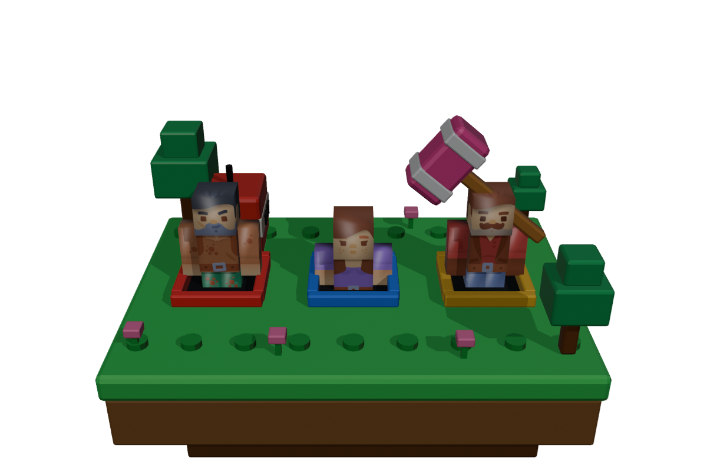
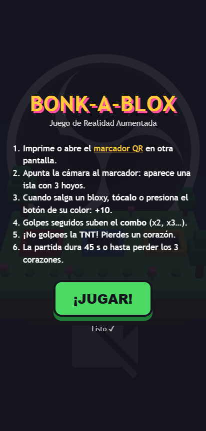
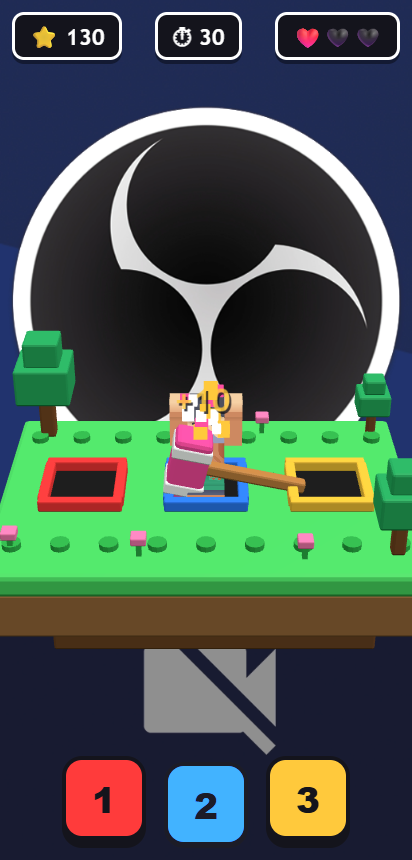
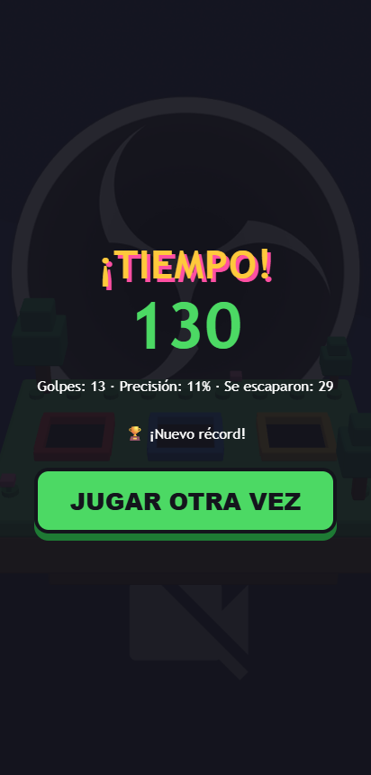
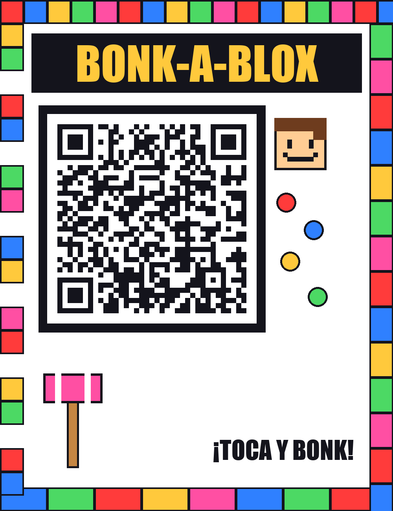

# Bonk-a-Blox AR 🔨🟩

Minijuego de **Realidad Aumentada** que se activa con un **marcador QR de diseño propio**. Al apuntar la cámara al marcador aparece una isla flotante de bloques con 3 hoyos; de ellos salen personajes estilo bloque y hay que darles "bonk" antes de que se escondan… sin tocar la TNT.

> Actividad 1 · Realidad Virtual y Aumentada: Juego de RA activado por marcador QR personalizado.

**▶ Jugar:** https://rosauraaa.github.io/bonk-a-blox-qr/
**🎥 Video demo:** _(agregar enlace al video de 30–60 s)_
**🖨 Marcador:** [`assets/marker/marker.png`](assets/marker/marker.png)



## Cómo se juega

| | |
|---|---|
| 🎯 **Objetivo** | Hacer la mayor cantidad de puntos en 45 segundos. |
| 🔨 **Golpear** | Toca al personaje en la pantalla **o** presiona el botón de su color (1 rojo, 2 azul, 3 amarillo). Cada golpe vale **+10**. |
| 🔥 **Combo** | Cada 5 golpes seguidos el multiplicador sube (x2, x3, x4). Fallar o dejar escapar a un personaje lo reinicia. |
| 💣 **TNT** | Si golpeas la TNT pierdes un ❤️. |
| 🏁 **Fin de partida** | Se acaba el tiempo o pierdes los 3 corazones. Se muestran el puntaje, la precisión y el récord. |
| ⏸ **Pausa** | Si la cámara pierde el marcador, el juego se pausa hasta volver a verlo. |

La dificultad sube durante la partida: los personajes salen más seguido, duran menos arriba y aparece más TNT.

**Retroalimentación táctil:** los botones se hunden y brillan; cada acción tiene un sonido sintetizado (bonk, explosión, fallo); el teléfono vibra al golpear (vibración corta) y al tocar TNT (doble vibración), y además salen partículas, un martillo animado, texto flotante (+10) y la pantalla tiembla.

## Capturas

| Inicio | Juego | Final |
|---|---|---|
|  |  |  |

> Estas capturas se tomaron en la compu con el modo `?demo`. Faltan las capturas desde el teléfono con el marcador.

## Herramientas

- **MindAR 1.2.5** (rastreo de imagen) + **three.js r160**: RA web, sin instalar app.
- **Blender 5.2**: modelado por script de la isla, la TNT y el martillo ([`blender/build_models.py`](blender/build_models.py)).
- **Python (qrcode + Pillow)**: diseño del marcador ([`tools/make_marker.py`](tools/make_marker.py)).
- **Web Audio API**: efectos de sonido sintetizados (no se usan archivos de audio).
- **Vibration API**: vibración en Android.

## El marcador QR personalizado



- El QR apunta a la página del juego: si lo escaneas con la cámara normal del teléfono, se abre el juego, y el juego usa la **misma imagen** como marcador.
- Un QR solo tiene patrones repetitivos que confunden al rastreador. Por eso lleva un **marco de bloques de colores distinto en cada lado**, un título, una carita pixel-art, un martillo y círculos de colores en posiciones asimétricas. Así el rastreador tiene puntos únicos y lo detecta rápido a distintas distancias.
- Alto contraste (negro sobre blanco) y nivel de corrección de errores **H**, para que el QR siga funcionando aunque se le agregue diseño.
- `assets/marker/marker.mind` es el marcador compilado para MindAR ([`tools/compile-marker.html`](tools/compile-marker.html)).

## Estructura

```
index.html              pantalla de inicio, HUD y botones 1-2-3
css/style.css
js/main.js              escena AR, lógica del juego, toques
js/sfx.js               sonidos (Web Audio) y vibración
assets/marker/          marker.png (imprimir) y marker.mind (compilado)
assets/models/          island.glb, tnt.glb, hammer.glb (propios) + kenney/ (CC0)
blender/build_models.py genera los modelos propios
tools/                  generar y compilar el marcador
docs/                   capturas y artículo
```

## Instalación y ejecución

No hay que compilar nada: es una página estática.

1. **En el teléfono (recomendado):** abre https://rosauraaa.github.io/bonk-a-blox-qr/ (o escanea el QR) y permite el uso de la cámara. Funciona en Chrome para Android y en Safari para iPhone.
2. Imprime el marcador o ábrelo en otra pantalla y apunta la cámara hacia él.
3. **En la compu (desarrollo):**
   ```bash
   npx serve .            # o: python -m http.server 8000
   ```
   Abre `http://localhost:3000`. La cámara solo funciona en `localhost` o con HTTPS. Para probar sin marcador usa `http://localhost:3000/?demo`.

### Publicar en GitHub Pages
Settings → Pages → *Deploy from a branch* → `main` / `(root)`.

### Regenerar los recursos (opcional)
```bash
blender -b -P blender/build_models.py        # modelos y docs/preview-modelos.png
pip install qrcode pillow
python tools/make_marker.py [url]            # marcador nuevo
npx serve .  →  abrir /tools/compile-marker.html y guardar marker.mind en assets/marker/
```

## Pruebas

- [ ] Teléfono 1: _(modelo / navegador)_
- [ ] Teléfono 2: _(modelo / navegador)_
- [ ] Marcador a 20 cm, 50 cm y 1 m

## Créditos y licencias

| Recurso | Autor | Licencia |
|---|---|---|
| Personajes `character-a/e/k.glb` (Blocky Characters 2.0) | [Kenney](https://kenney.nl/assets/blocky-characters) | [CC0 1.0](assets/models/kenney/License.txt) |
| Isla, TNT y martillo (`island.glb`, `tnt.glb`, `hammer.glb`) | Rosaura Quintana (Blender) | CC BY 4.0 |
| Marcador QR | Rosaura Quintana | CC BY 4.0 |
| Efectos de sonido | Rosaura Quintana (sintetizados con Web Audio) | CC BY 4.0 |
| [three.js](https://threejs.org) | three.js authors | MIT |
| [MindAR](https://github.com/hiukim/mind-ar-js) | HiuKim Yuen | MIT |

Código bajo licencia [MIT](LICENSE).
